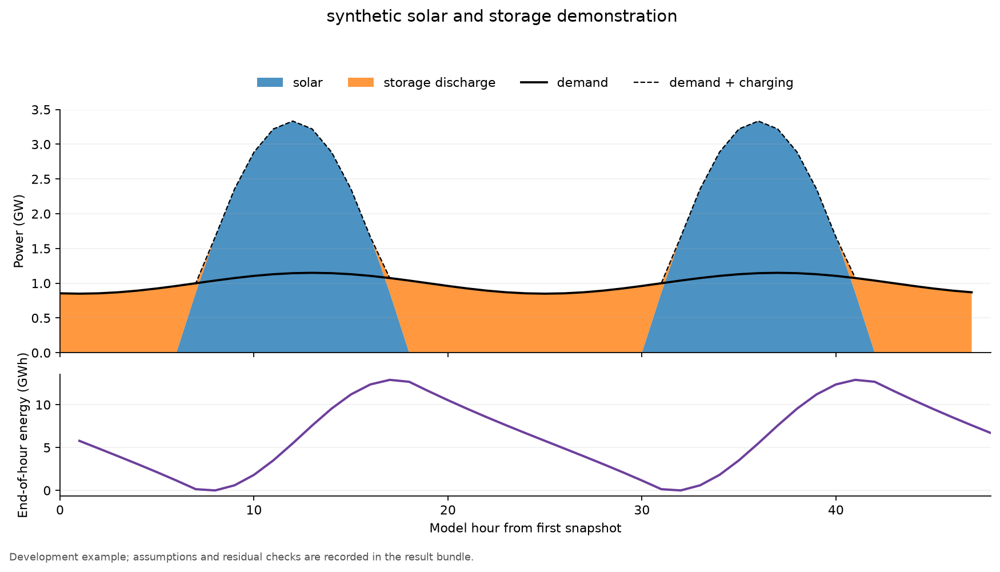

# Foundation validation, 7 November 2026

This record concerns execution and accounting of the new formulation. All
numerical examples use historical or explicitly synthetic inputs. They do
not establish a contemporary energy-system optimum.

## Executable checks

- Development checkout: **31 tests passed**.
- Fresh checkout without ignored raw data: **30 passed, one explicitly
  skipped** recovered-trace test.
- Both public CLI examples solved and passed independent accounting.
- GitHub Actions tests and secret scan passed at implementation commit
  `37b91873bd4748f1a9c7182ac06b533a8793bbc8`.
- The source-preservation check and parameter-conversion check passed in a
  fresh checkout. Git attributes preserve original CRLF bytes and CSV hashes.
- All 31 raw CSVs were catalogued and hash-verified; a separate storage copy
  was checked against the same manifest. Large raw files are not distributed
  in the public repository.

The analytical tests include availability derating, exact renewable matching,
curtailment, idle capacity costs, carbon charges, both emissions-cap scopes,
infeasibility, demand scaling, duplicated weather scenarios, technology order,
independent capacity enumeration, storage losses and physical duration,
per-period cycling and absence of cross-year energy transfer. Independent
checker mutation tests reject incorrect costs, generation bounds, imbalance,
nonfinite values, emissions violations and energy borrowed between periods.

## Recovered-data integration

| Case | Hours | Weather periods | Solver | Outcome | Solve seconds |
|---|---:|---:|---|---|---:|
| Historical baseline | 70,080 | 8 | HiGHS automatic | Optimal; independent audit passed | 46.70 |
| Illustrative 0.1 tCO2/MWh cap, first weather year | 8,760 | 1 | HiGHS interior point | Optimal; independent audit passed | 20.52 |

Maximum hourly balance residual in both cases was approximately
`7.28e-12 MW`. The one-year constraint achieved `0.10000000000000027`
tCO2/MWh, within the declared numerical tolerance. Reconstructed objective
cost differed from solver objective by less than $0.002 in either case.

The full baseline was repeated from a clean checkout of the public
implementation commit, with `git_dirty=false`. Its expected annual demand
was 232.8075166 TWh. For reproducibility, the complete small summaries,
capacity tables and period tables are stored in
[`results/validation_2026-11-07/`](../results/validation_2026-11-07/).
Hourly dispatch remains in generated result bundles outside Git.

Reproduce with the selected historical trace restored:

```sh
uv run energymod solve --config config/historical.toml --output outputs/historical
uv run energymod solve --config config/historical_low_emissions_one_year.toml --output outputs/limited
```

The single-year configuration reweights the selected complete period to
8,760 annual hours; it does not retain one-eighth probability after selection.
The reported run uses Python 3.12.3, NumPy 2.5.4 and SciPy 1.18.1. The latter
bundles HiGHS 1.12.0 in the tested build. The locked package artifacts and
per-run input/source hashes identify the numerical environment.

## Bounded stress test

The eight-weather-year case with a separate 0.1 tCO2/MWh constraint in every
year hit its **600-second solver limit** with both automatic HiGHS and
`highs-ipm`. Neither produced an accepted optimum. Both failed explicitly
and wrote failure metadata; they are not counted as validated full-data
solutions. Memory use remained below about 1 GiB in the observed processes.

The smaller one-weather-year constrained case solved and passed all checks.
The full constrained ensemble is a documented performance follow-up, rather
than a reason to weaken the optimality or accounting checks or silently
aggregate hours. Failure records are included with the small validation
artifacts. No stress jobs remain running.

## Interpretation and further work

The independent methodological review found no material error in the stable
LP equations, sparse indexing, annualisation, nameplate derating or separate
period storage cycles. A storage-bound indexing error found during unit
testing was corrected before the committed implementation.

The key uncertainties remain demand preprocessing, historical costing,
constant thermal derating, resource availability, fixed spatial aggregation,
perfect foresight and alternate optimal capacity vectors. Weather-sampling
and availability sensitivities are needed before interpreting a particular
mix. A paper-grade claim would require a separate scientific validation
tranche and documented data sources.

## Illustrative storage example

The public synthetic example charges storage from solar, discharges it to
meet night demand, and accounts for round-trip losses. Its storage costs
and efficiencies are illustrative. This plot is a check of the implemented
chronology, not a historical-data result.



```sh
uv run energymod solve --config config/illustrative_storage.toml --output outputs/storage
uv run --group plots python scripts/plot_run.py outputs/storage --hours 48 --output outputs/storage/dispatch.png
```
