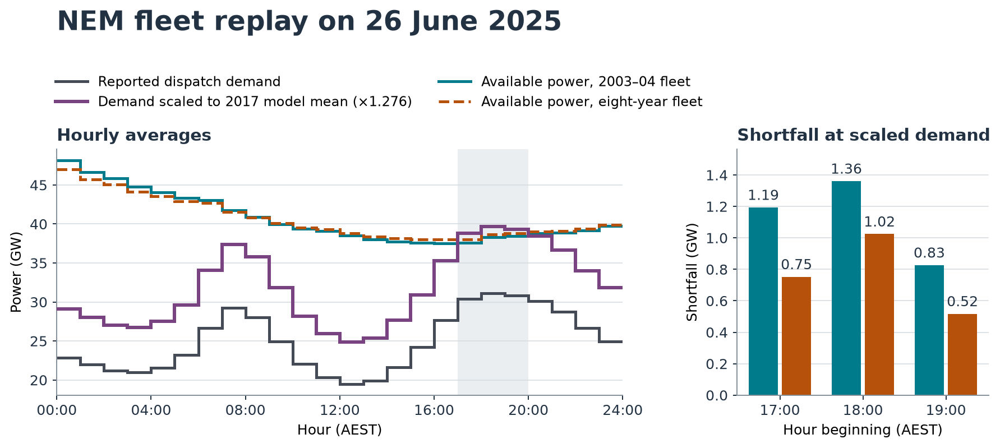

# The 2003–04 fleet on newer NEM weather

The 2003–04 fleet served all **26,304 hours** of reported dispatch demand across the five NEM regions from July 2023 through June 2026. So did the joint fleet designed on all eight historical weather years. Demand peaked at 33.45 GW, below the 2003–04 fleet's 36.53 GW of available gas alone. Including wind, the smallest hourly surplus was 7.19 GW for the 2003–04 fleet and 7.55 GW for the joint fleet. Both also covered every available hour of measured operational demand. [Historical fleet capacities](../weather_test_2017/fleets.csv) · [Replay results](periods.csv)

## At the demand level the fleets were designed for

The original model assumed 232.81 TWh in 8,760 hours. The modern dispatch series averaged 182.48 TWh per 8,760 hours. Multiplying all modern hourly loads by **1.27579** gives the old mean while preserving the timing of demand, wind and solar and the differences among years. On that test both fleets ran short in every year. The historical comparison had paired the same projected demand curve with eight different wind and solar traces. [Historical weather test](../weather_test_2017/README.md)

| Operating year | 2003–04 hours short | Joint hours short | 2003–04 peak deficit (GW) | Joint peak deficit (GW) | 2003–04 unserved (GWh) | Joint unserved (GWh) |
|---|---:|---:|---:|---:|---:|---:|
| 2023–24 | 7 | 6 | 1.13 | 0.73 | 5.18 | 3.03 |
| 2024–25 | 13 | 11 | 1.36 | 1.02 | 7.40 | 5.12 |
| 2025–26 | 2 | 1 | 1.10 | 0.89 | 1.29 | 0.89 |
| **Three years** | **22** | **18** | **1.36** | **1.02** | **13.86** | **9.05** |

All shortages fell in June or July, in hours beginning between 17:00 and 19:00 AEST. The worst spell lasted three hours on **26 June 2025**. At 18:00, scaled demand reached 39.66 GW and the wind forecast was 5.30% of rated capacity. The 2003–04 fleet had 36.53 GW of gas and 1.77 GW of wind available. The joint fleet had 37.13 GW of gas and 1.51 GW of wind. Both fleets have zero solar and storage capacity. [All shortage events and peak-hour conditions](events.csv)



The joint design gives up 5.07 GW of wind nameplate for 0.60 GW more available gas. The fleets have equal available power at precisely 12% wind availability, before the historical 0.99 derating. Below that threshold the joint fleet has the advantage. It reduced or eliminated the deficit in 20 of the 22 affected hours. In the other two, wind exceeded 12% and the wind-heavier 2003–04 fleet shed slightly less. Across all three years, a uniform increase of **23.20%** in reported dispatch demand would first exhaust the 2003–04 fleet's headroom. The joint fleet reached that point at **24.28%**.

## How the demand definition changes the answer

AEMO's five-minute `TOTALDEMAND` is the dispatch forecast of scheduled demand at the end of the interval. The published half-hourly `OPERATIONAL_DEMAND` measures operational demand, which excludes rooftop generation. In the monthly archive, the measured series covers August 2024 through June 2026. Across those 16,776 matched hours, hourly dispatch demand averaged 345 MW below measured operational demand. Their correlation was 0.9985. With no scaling, both fleets covered both series. With the same 1.27579 multiplier, measured demand produced 11 shortage hours for the 2003–04 fleet and 10 for the joint fleet. The worst hour stayed at 18:00 on 26 June 2025, with deficits of 1.39 and 1.05 GW. [AEMO demand terms](https://www.aemo.com.au/-/media/files/electricity/nem/security_and_reliability/dispatch/policy_and_process/demand-terms-in-emms-data-model.pdf) · [AEMO operational demand and underlying demand](https://www.aemo.com.au/energy-systems/electricity/national-electricity-market-nem/data-nem/operational-demand-data)

**2025–26 allows a comparison at exactly the same annual energy.** It is the only full year here with both measured demand and complete rooftop estimates. Each row below scales its own hourly shape to 232.81 TWh. Positive margins are spare capacity. Adding rooftop generation back to measured grid demand asks what the fleet could serve if it also had to supply that consumption. Rooftop generation enters only on the demand side in this case.

| 2025–26 demand shape | Before scaling (TWh) | 2003–04 minimum margin (GW) | Joint minimum margin (GW) | Tightest hour (AEST) |
|---|---:|---:|---:|---|
| Dispatch demand | 183.60 | −0.85 | −0.65 | 29 July 2025, 18:00 |
| Measured operational demand | 186.65 | +0.14 | +0.34 | 29 July 2025, 18:00 |
| Measured operational demand plus rooftop generation | 216.97 | +0.97 | +1.14 | 30 January 2026, 12:00 |

The winter shortfall in June 2025 appears in both demand records under the common three-year scaling. The verdict for 2025–26 alone depends on the demand definition and scaling. The old demand file supplies no verified mapping to today's rooftop accounting. [Demand and scaling cases by period](periods.csv)

## Matching the weather

- **Time and geography.** The five NEM regions are NSW, Queensland, South Australia, Tasmania and Victoria. We aggregated each source on its interval-ending market timestamp, converted to hourly means and joined by the beginning of the hour in fixed AEST (UTC+10). The first financial year includes 29 February 2024. The primary demand and renewable series supply twelve five-minute intervals per hour. Measured demand and rooftop estimates use two half-hours. Physical intervention runs take precedence when AEMO publishes a separate pricing run. [Monthly AEMO archives](https://www.nemweb.com.au/Data_Archive/Wholesale_Electricity/MMSDM/)
- **Renewable footprint.** AEMO's May 2023 register identified 116 in-service, semi-scheduled wind or solar units by dispatch ID. Six additional entries had no ID. We kept 112 units with unchanged positive registered MW and complete forecasts across the available intervals. Three solar units lacked a starting rating and one wind unit changed rating. The fixed cohort totals 8,027 MW at 56 wind units and 5,100 MW at 56 solar units. Each profile is the sum of unit forecasts divided by the cohort's registered MW. Victoria and South Australia account for 64% of the wind MW. This modern site distribution stands in for the unknown spatial weights of the recovered trace. [May 2023 AEMO generation information](https://www.aemo.com.au/-/media/files/electricity/nem/planning_and_forecasting/generation_information/2023/nem-generation-information-may-2023.xlsx?rev=e97a0e72cd5840f98f18a20408a3bfbf&sc_lang=en)
- **Available power.** AEMO's unconstrained intermittent generation forecast (UIGF) estimates available output ahead of dispatch curtailment and can reflect plant conditions and local limits. Before the interval ending 13:40 on 7 August 2023, the semi-scheduled availability field supplied that forecast. Nine controls on both sides of the change and around archive gaps matched 1,017 unit-level values in the original dispatch inputs to within 0.000006 MW. We applied the historical 0.95 gas and 0.99 wind deratings throughout. Setting wind derating to 1.0 changed the scaled shortfall counts from 22 to 21 for 2003–04 and left the joint fleet at 18. [AEMO dispatch change](https://www.aemo.com.au/energy-systems/electricity/national-electricity-market-nem/nem-forecasting-and-planning/operational-forecasting/solar-and-wind-energy-forecasting/updates-and-initiatives/enablement-of-bid-max-avail-for-semi-scheduled-generators)
- **Source gaps.** Original dispatch cases recovered all 240 missing five-minute intervals on 30 September 2025. Both AEMO sources lacked the intervals starting 13:40 and 13:45 on 5 December 2023. Even with zero renewable output for the entire hour, the smaller gas fleet could cover the scaled 25.11 GW demand. Setting the two missing intervals anywhere from zero to full rated renewable output leaves every shortage and minimum margin unchanged. The two hours with incomplete rooftop data in September 2024 fall outside the full-year rooftop comparison. [AEMO dispatch case archives](https://www.nemweb.com.au/Data_Archive/Wholesale_Electricity/NEMDE/)

Each replay uses the published fleet capacities at full precision. A shortage occurs when demand exceeds available generation by more than 0.00001 MW. An independent calculation rebuilt the hourly margins and the shortage events from the separate demand and renewable series. These are hourly balances for a single NEM-wide system with deterministic gas availability. Network bottlenecks, operating reserves and individual generator outages would change what that capacity could deliver. Estimating future blackout risk would require a longer weather record and a model of those operating constraints.

## Reproduction

From a fresh clone, the first command group fetches and verifies 137 AEMO files (4.69 GB). The manifest records the source URL, byte count and SHA-256 of each file. Original AEMO materials remain subject to AEMO's terms. [Source manifest](../../data/nem_replay_sources.csv) · [AEMO copyright permissions](https://www.aemo.com.au/privacy-and-legal-notices/copyright-permissions)

```sh
inputs=data/traces/modern_nem
uv sync --locked --group inputs
uv run --locked python scripts/fetch_nem_archives.py "$inputs"
uv run --locked --group inputs python scripts/modern_cohort.py "$inputs/may.xlsx" "$inputs/cohort.csv"
uv run --locked --group inputs python scripts/modern_case_uigf.py "$inputs/cohort.csv" "$inputs/nemde_case" --dispatch-archives "$inputs/archives"
uv run --locked --group inputs python scripts/modern_resources.py "$inputs/archives" "$inputs/cohort.csv" "$inputs/nemde_case/patches.csv" "$inputs/resources"
uv run --locked python scripts/modern_demand.py "$inputs/archives" "$inputs/hourly_demand.csv"
```

Run the fixed-fleet replay into fresh canonical and results directories. The saved plot uses the canonical dispatch trace and the published demand multiplier.

```sh
uv run --locked python scripts/run_modern_replay.py "$inputs/hourly_demand.csv" "$inputs/resources/resource_hours.csv" "$inputs/canonical" outputs/modern_weather_replay
uv run --locked --group plots python scripts/plot_modern_replay.py
```

[Period results](periods.csv) include the physical hours, scale factors, tightest-hour conditions and wind-derating sensitivities. [Events](events.csv) give start and exclusive end times. [Provenance](provenance.json) records the hourly inputs, frozen fleet, software and preprocessing hashes.
