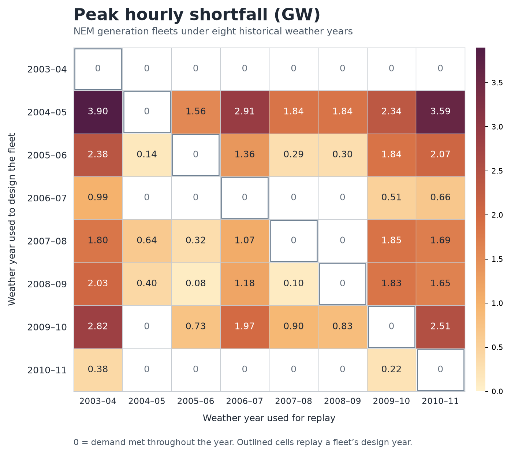

# Choosing a NEM fleet before knowing the weather year

Seven of the eight least-cost single-year fleets failed to meet demand in at least one other year. The fleet designed for 2003–04 covered every hour of all eight. On the same eight years it cost **$15.1 million/year more** than the jointly optimised fleet, a difference of 0.070%.

## Which fleets came up short?

Each row shows a fleet built for one July–June weather year. Capacities stayed fixed as that fleet served the same projected demand under each of the eight wind and solar traces. All eight fleets passed their design year. Shortfalls occurred in 38 of the 56 other fleet–weather combinations.



| Design year | Other years with a shortage (of 7) | Largest shortfall (GW) | Hours short across the full eight-year replay |
|---|---:|---:|---:|
| 2003–04 | 0 | 0 | 0 |
| 2004–05 | 7 | 3.90 | 77 |
| 2005–06 | 7 | 2.38 | 27 |
| 2006–07 | 3 | 0.99 | 6 |
| 2007–08 | 6 | 1.85 | 29 |
| 2008–09 | 7 | 2.03 | 28 |
| 2009–10 | 6 | 2.82 | 19 |
| 2010–11 | 2 | 0.38 | 2 |

## What happened in the worst hours?

**At 18:00 on 3 July 2003, every fleet designed for another year fell short.** The repeated demand profile called for 40.54 GW. Wind output was 12% of the trace's nominal capacity and solar 1%, before the separate plant derating. At the same demand hour in its own design year, the vulnerable 2004–05 fleet had a wind profile of 43%. In the 2003 replay it could deliver only 32.61 GW from gas, 4.01 GW from wind and 0.02 GW from solar, leaving 3.90 GW unserved. Even the 2010–11 design missed by 0.38 GW. The joint fleet met this hour with 37.13 GW of gas and 3.41 GW of wind.

The largest power deficit, largest energy deficit and longest interruption occurred in three distinct spells. Times below are as labelled in the weather trace. Each hour starts at the time shown.

| What was largest? | Fleet and weather date | Shortage hours | Peak (GW) | Energy unserved (GWh) | Conditions at peak |
|---|---|---:|---:|---:|---|
| Power | 2004–05 fleet, 3 July 2003 | 18:00–19:00 inclusive (2 h) | 3.90 | 4.07 | 40.54 GW demand, wind at 12%, solar at 1% |
| Energy in one spell | 2004–05 fleet, 2 July 2010 | 17:00–20:00 inclusive (4 h) | 3.59 | 8.27 | At 18:00 demand reached 39.88 GW, wind was at 11% and solar zero |
| Duration (tie) | 2004–05 and 2005–06 fleets, 25 February 2011 | 11:00–16:00 inclusive (6 h) | 1.72 / 1.68 | 6.32 / 6.17 | At 14:00 demand was 38.81 GW, wind was at 9% and solar at 75% |

The February event shows a different route to shortage. Solar supplied 1.47 GW for the 2004–05 fleet, which had 1.98 GW of panels. The 2005–06 fleet had no solar and supplied more from gas. Both fell short for the same six hours. Across the experiment, 89 of 124 fleet-specific shortage spells lasted one hour. A single weather event can count for several fleets. The largest **full-year** energy shortfall was 20.55 GWh across 19 hours for the 2004–05 fleet in 2010–11.

## What does eight-year coverage cost?

| Fleet choice | Expected annual system cost ($bn/year) | Cost per MWh of demand |
|---|---:|---:|
| Choose the cheapest fleet separately for each known year, then average | 21.4612 | $92.184 |
| Choose one fleet jointly across all eight years | 21.6079 | $92.814 |
| Choose the 2003–04 fleet and operate it in all eight years | 21.6230 | $92.879 |

The first row gives the lower bound achievable if a planner could know the year's weather before building. The joint fleet costs **$146.74 million/year more, or $0.630/MWh (0.684%)**. It builds **39.08 GW of open-cycle gas and 28.73 GW of wind**. Its annual fixed cost is $10.768 billion and its mean variable cost is $10.840 billion. Relative to the average of the designs built with advance knowledge, it spends $533 million/year less on fixed costs and $680 million/year more on operating costs. These figures are annualised system costs in the recovered model's dollars. The input tables do not establish an upfront construction bill or a monetary base year.

The 2003–04 design gets almost the same eight-year cost with **38.45 GW of gas and 33.80 GW of wind**. It is the only single-year design that can be compared with the joint fleet on fully served demand across all years. Picking it using its eight-year performance would require hindsight.

## Reproduction and checks

Run from the repository root with the catalogued historical trace restored.

```sh
uv sync --locked --group plots
uv run python scripts/run_weather_test.py outputs/weather_test
uv run --group plots python scripts/plot_weather_test.py outputs/weather_test/pairs.csv outputs/weather_test/peak_shortfall.png
```

The analysis reads [the historical configuration](../../config/historical.toml). Each single-year solve covers 8,760 physical hours and pays its annual fixed costs once. The joint design meets all 70,080 hours and weights the eight years equally. All five historical technologies were eligible. Storage, carbon pricing and emissions limits were disabled.

All nine optimisations passed the independent model audit. The replay first serves as much demand as available capacity allows, then dispatches by variable cost. Deficits above 0.00001 MW start a shortage. Consecutive physical intervals form an event, and a calendar gap ends it. Off-diagonal costs include only fixed costs and the cost of generation actually dispatched. Those costs cannot rank fleets with different amounts of unmet demand. The cost comparison above uses only fully served demand. The joint replay reproduces the original [historical baseline](../validation_2026-11-07/historical_summary.json). A second calculation from the raw trace and frozen capacities verified the 64 cells, all 124 spells and the cost premium independently of the replay code.

The eight weather years share one projected 2049–50 hourly demand curve. Weather dates label modelled demand–supply combinations. These are simulated shortfalls in a single-bus system with deterministic availability. Real demand varies with weather, and these eight years alone cannot establish future event probabilities.

- [Fleet capacities, fitted costs and checks](fleets.csv)
- [All 64 fixed-fleet replays](pairs.csv) and [joint fleet by operating year](joint_replay.csv)
- [Every shortage spell and its peak-hour conditions](events.csv)
- [Cost comparison](summary.json) and [input, software and analysis hashes](provenance.json)
